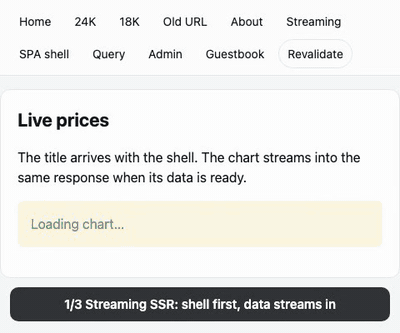

# ssr-kit

[](https://github.com/Ahnseungc/ssr-kit/actions/workflows/ci.yml)
[](https://github.com/Ahnseungc/ssr-kit/blob/main/LICENSE)

**React 19 streaming SSR as one middleware for the Node server you already have. Built with Vite 8, no framework lock-in.**

<p align="center">
  
</p>

<p align="center">
  <b><a href="#run-the-demo">Run the demo →</a></b> (Express, or Cloudflare Workers locally)
</p>

## Why

Next.js owns your server. ssr-kit is a function you mount on it.

| With Next.js App Router                                       | With ssr-kit                                                                 |
| ------------------------------------------------------------- | ---------------------------------------------------------------------------- |
| The framework owns the server; custom servers are discouraged | `app.use(createSsrHandler({ build }))` on Express, Fastify, Hono, or Workers |
| Implicit caching rules that change between majors             | Caching is plain HTTP headers. Default `Cache-Control: private, no-store`    |
| `'use client'` boundaries and an RSC payload next to the HTML | Classic SSR + hydration. Every component runs on both sides                  |
| File conventions decide your routes                           | Routes are code (`defineRoutes`). File routes are an optional plugin         |
| Opaque bundler config                                         | Your `vite.config.ts` is the source of truth                                 |
| Self-hosting needs extra cache and image setup                | It is just your Node server (or a Worker)                                    |

[한국어 문서](https://github.com/Ahnseungc/ssr-kit/blob/main/docs/README.ko.md)

## Features

- **Streaming SSR**: the shell goes out first. Return a Promise from a loader and `use()` it inside `<Suspense>`; the data streams into the same response.
- **Loaders and actions**: `loader` (GET) and `action` (POST/PUT/PATCH/DELETE) are route-module exports that are stripped from the client bundle. `<Form>` works without JavaScript, and without a page reload once hydrated.
- **Route middleware**: onion-style `middleware` runs before loaders and actions on every document and data request. Put auth guards here.
- **Client navigation**: `<Link>` fetches only loader data (`/_data/*`), with intent / viewport prefetch, scroll restoration, and a redirect loop guard.
- **Type-safe links**: generated route types make `<Link to="/gol/1">` a compile error. `href('/gold/:id', { id })` builds URLs.
- **Server-only code stays on the server**: `loader`, `action`, `middleware`, their helpers, and their imports are removed from the client bundle. Importing a `*.server.ts` file from client code fails the build.
- **Adapters**: Node (`(req, res, next)`, works with Express / Connect), Fastify, Hono, Web `Request → Response`, and an edge adapter with no `node:*` imports for Cloudflare Workers.
- **Errors**: route `ErrorBoundary`, `notFound()`, `redirect()`, `httpError()`. Production hides internal messages. Dev shows server errors in the Vite overlay.
- **Old WebViews**: works with `@vitejs/plugin-legacy`; ssr-kit adds the nomodule scripts that SSR pages otherwise miss.
- **Extras**: `head()` merging, CSP nonce, `Server-Timing`, prerender to static HTML, file-based routes, React Fast Refresh for route modules.
- Client runtime **5.7 KB** min+gzip. No runtime dependencies besides React.

## Install

```bash
npm install ssr-kit react react-dom
npm install -D vite @vitejs/plugin-react
```

| Import              | For                                                  | Peer dependency |
| ------------------- | ---------------------------------------------------- | --------------- |
| `ssr-kit`           | Routes, hooks, `Link`, `Form`, `Outlet`, `Head`      | `react` 19      |
| `ssr-kit/vite`      | `ssrKit()` plugin, `fsRoutes()`, `createDevServer()` | `vite` 8        |
| `ssr-kit/node`      | Express, Connect, `node:http`                        | none            |
| `ssr-kit/fastify`   | Fastify plugin                                       | `fastify` 5     |
| `ssr-kit/hono`      | Hono middleware                                      | `hono` 4        |
| `ssr-kit/web`       | `Request → Response` on Node, Bun, Deno              | none            |
| `ssr-kit/edge`      | Cloudflare Workers, Vercel Edge (no `node:*`)        | none            |
| `ssr-kit/server`    | `handleRequest()`, low-level `render()`              | none            |
| `ssr-kit/prerender` | Static HTML (CLI: `ssr-kit-prerender`)               | none            |

Only install the peers you use. Node 22+.

## Quick start

**1. Vite plugin**

```ts
// vite.config.ts
import react from "@vitejs/plugin-react";
import { ssrKit } from "ssr-kit/vite";
import { defineConfig } from "vite";

export default defineConfig({
  plugins: [react(), ssrKit({ routes: "./src/routes.ts", document: "./src/Document.tsx" })],
});
```

**2. Routes as code**

```ts
// src/routes.ts
import { defineRoutes } from "ssr-kit";

export default defineRoutes([
  {
    id: "root",
    module: () => import("./pages/Layout"),
    children: [
      { path: "/", module: () => import("./pages/Home") },
      { path: "gold/:id", module: () => import("./pages/Gold") },
    ],
  },
]);
```

**3. A route module**

```tsx
// src/pages/Gold.tsx
import { Suspense, use } from "react";
import { type LoaderArgs, notFound, useLoaderData } from "ssr-kit";

import { findGold, priceHistory } from "../db.server"; // never reaches the browser

export const loader = async ({ params, headers }: LoaderArgs<"/gold/:id">) => {
  const gold = await findGold(params.id);
  if (!gold) notFound();
  headers.set("Cache-Control", "private, max-age=0");
  // not awaited: the shell is sent now, the chart streams in later
  return { gold, history: priceHistory(params.id) };
};

export const head = ({ data }: { data: { gold: { name: string } } }) => ({ title: data.gold.name });

function Chart({ history }: { history: Promise<number[]> }) {
  return <p>{use(history).join(" → ")}</p>;
}

export default function Gold() {
  const { gold, history } = useLoaderData<typeof loader>();
  return (
    <main>
      <h1>{gold.name}</h1>
      <Suspense fallback={<p>Loading chart…</p>}>
        <Chart history={history} />
      </Suspense>
    </main>
  );
}
```

**4. Mount it on your server**

```ts
// server.ts
import express from "express";
import { createSsrHandler } from "ssr-kit/node";

const app = express();

if (process.env.NODE_ENV === "production") {
  app.use("/assets", express.static("dist/client/assets", { immutable: true, maxAge: "1y" }));
  app.use(express.static("dist/client", { index: false }));
  const { build } = await import("./dist/server/entry.js");
  app.use(createSsrHandler({ build }));
} else {
  const { createDevServer } = await import("ssr-kit/vite");
  const dev = await createDevServer({ root: import.meta.dirname });
  app.use(dev.middlewares);
  app.use(async (req, res, next) => createSsrHandler({ build: await dev.getBuild() })(req, res, next));
}

app.listen(3000);
```

`vite build` writes `dist/client` and `dist/server/entry.js`. Your API routes and middleware stay plain Express.

<details>
<summary><b>Cloudflare Workers</b></summary>

```ts
// worker.ts
import { createEdgeHandler } from "ssr-kit/edge";
import { build } from "./dist/server/entry.js";

const handle = createEdgeHandler({ build });

export default {
  async fetch(request: Request, env: { ASSETS: Fetcher }) {
    return (await handle(request)) ?? env.ASSETS.fetch(request);
  },
};
```

```jsonc
// wrangler.jsonc
{
  "main": "worker.ts",
  "compatibility_flags": ["nodejs_compat"],
  "assets": { "directory": "dist/client", "binding": "ASSETS" }
}
```

Streamed documents are sent with `Content-Encoding: identity` so the runtime does not hold them back for compression.

</details>

<details>
<summary><b>Hono</b></summary>

```ts
import { Hono } from "hono";
import { ssrKit } from "ssr-kit/hono";

const app = new Hono();
app.get("/api/ping", (c) => c.text("pong"));
app.use("*", ssrKit({ build })); // unmatched requests fall through to your routes
```

</details>

<details>
<summary><b>Fastify</b></summary>

```ts
import Fastify from "fastify";
import { ssrKit } from "ssr-kit/fastify";

const app = Fastify();
await app.register(ssrKit, { build });
```

</details>

## Mutations

```tsx
// src/pages/Guestbook.tsx
import { type ActionArgs, Form, redirect, useActionData, useNavigation } from "ssr-kit";

export const action = async ({ request }: ActionArgs<"/guestbook">) => {
  const form = await request.formData();
  const message = String(form.get("message") ?? "").trim();
  if (!message) return { error: "Write something" };
  await save(message);
  redirect("/guestbook"); // Post/Redirect/Get, sent as 303
};

export default function Guestbook() {
  const result = useActionData<typeof action>();
  const busy = useNavigation().state === "submitting";
  return (
    <Form method="post">
      <input name="message" />
      <button disabled={busy}>{busy ? "Sending…" : "Send"}</button>
      {result?.error && <p role="alert">{result.error}</p>}
    </Form>
  );
}
```

The action runs inside the route middleware, then the loaders run again in the same response. Requests from another origin get `403`.

## Middleware

```ts
// src/pages/Admin.tsx
import { type Middleware, redirect } from "ssr-kit";

export const middleware: Middleware = async ({ request, context }, next) => {
  const user = await getSession(request); // from a *.server.ts module
  if (!user) redirect(`/login?next=${request.url.pathname}`);
  context.user = user; // loaders and actions get the same context
  await next();
};
```

Middleware runs root to leaf on every document, data, and action request, so client navigation cannot skip a guard.

## API

| API                                         | What it does                                                                                                   |
| ------------------------------------------- | -------------------------------------------------------------------------------------------------------------- |
| `defineRoutes(routes)`                      | Route tree: `path` (`:id`, `:lang?`, `*`), `module`, `children`, `ssr: false`                                  |
| `loader` / `action` / `middleware`          | Server-only route-module exports                                                                               |
| `head` / `ErrorBoundary`                    | Route-module exports for `<head>` tags and errors                                                              |
| `useLoaderData()` / `useActionData()`       | Data for the current route, typed with `typeof loader` / `typeof action`                                       |
| `useRouteLoaderData(id)`                    | Data of another matched route                                                                                  |
| `useNavigation()`                           | `{ state: "idle" \| "loading" \| "submitting", location, formData }`                                          |
| `useNavigate()` / `useRevalidate()`         | Navigate in code / run the current loaders again                                                               |
| `useSubmit()`                               | Submit `FormData` or an object from code                                                                       |
| `useParams()` / `useLocation()`             | Route params and location                                                                                      |
| `<Link to prefetch>` / `<Form>`             | Client navigation / mutations that also work without JavaScript                                                |
| `<Outlet>` / `<Head>`                       | Child route slot / merged head tags (put it in your `Document`)                                                |
| `redirect()` / `notFound()` / `httpError()` | Throw from loaders, actions, and middleware                                                                    |
| `href(pattern, params)`                     | Build a URL from a route pattern                                                                               |
| `createSsrHandler(options)`                 | Node handler. Options: `getContext`, `renderTimeout`, `getNonce`, `onError`, `serverTiming`, `allowedOrigins` |

The full design is in the [spec](https://github.com/Ahnseungc/ssr-kit/blob/main/docs/specs/ssr-kit/spec.md). What is verified, and how, is in the [verification table](https://github.com/Ahnseungc/ssr-kit/blob/main/docs/specs/ssr-kit/verification.md).

## Run the demo

The example app in [`packages/example`](https://github.com/Ahnseungc/ssr-kit/tree/main/packages/example) covers streaming, mutations, middleware, error boundaries, TanStack Query, and old-WebView bundles.

```bash
pnpm install
pnpm build && pnpm example:build
pnpm --filter ssr-kit-example start      # Express → http://localhost:3000
pnpm --filter ssr-kit-example demo:dev   # Cloudflare Workers (local) → http://localhost:4600
```

Open `/stream?delay=2000` to watch the shell arrive before the data. `node packages/example/scripts/record-demo.mjs` records the GIF above.

## Contributing

```bash
pnpm install
pnpm build          # build ssr-kit
pnpm lint && pnpm typecheck
pnpm test:coverage  # Vitest, core/server line coverage ≥ 90%
pnpm size           # runtime size budget
pnpm example:build && pnpm e2e   # Playwright against the production build
```

## License

[MIT](https://github.com/Ahnseungc/ssr-kit/blob/main/LICENSE)
