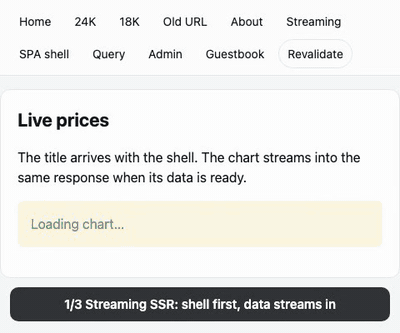

# ssr-kit

[](https://www.npmjs.com/package/ssr-kit)
[](https://github.com/Ahnseungc/ssr-kit/actions/workflows/ci.yml)
[](https://github.com/Ahnseungc/ssr-kit/blob/main/LICENSE)

**이미 있는 Node 서버에 미들웨어 하나로 붙는 React 19 스트리밍 SSR. Vite 8 기반이고 프레임워크에 묶이지 않습니다.**

<p align="center">
  <a href="https://ssr-kit-demo.omnipo58-e94.workers.dev/stream?delay=1500"></a>
</p>

<p align="center">
  <b><a href="https://ssr-kit-demo.omnipo58-e94.workers.dev/stream?delay=1500">라이브 데모 →</a></b> (Cloudflare Workers 에 올린 예제 앱)
</p>

## 왜 만들었나

Next.js 는 서버를 가져갑니다. ssr-kit 은 내 서버에 붙이는 함수 하나입니다.

| Next.js App Router                                        | ssr-kit                                                                          |
| --------------------------------------------------------- | -------------------------------------------------------------------------------- |
| 프레임워크가 서버를 소유, custom server 는 비권장         | Express·Fastify·Hono·Workers 에 `app.use(createSsrHandler({ build }))`           |
| 메이저마다 바뀌는 암묵 캐싱 규칙                          | 캐시는 HTTP 헤더로만. 기본 `Cache-Control: private, no-store`                    |
| `'use client'` 경계와 HTML 옆에 붙는 RSC payload          | 클래식 SSR + hydrate. 모든 컴포넌트가 서버·클라 양쪽에서 실행                    |
| 파일 컨벤션이 라우트를 정함                               | 라우트는 코드(`defineRoutes`). 파일 라우팅은 선택형 플러그인                     |
| 들여다보기 어려운 번들러 설정                             | 내 `vite.config.ts` 가 기준                                                      |
| self-host 시 캐시·이미지 설정이 따로 필요                 | 그냥 내 Node 서버(또는 Worker)                                                   |

[English](https://github.com/Ahnseungc/ssr-kit/blob/main/README.md)

## 기능

- **스트리밍 SSR**: 셸이 먼저 나갑니다. 로더가 Promise 를 반환하고 `<Suspense>` 안에서 `use()` 하면 같은 응답으로 이어서 스트리밍됩니다.
- **로더와 action**: `loader`(GET), `action`(POST/PUT/PATCH/DELETE) 은 라우트 모듈 export 이고 클라 번들에서 지워집니다. `<Form>` 은 JS 없이도, hydrate 뒤에는 새로고침 없이 동작합니다.
- **라우트 미들웨어**: onion 방식 `middleware` 가 모든 문서·데이터 요청에서 로더·action 보다 먼저 돕니다. 인증 가드는 여기에 둡니다.
- **클라 이동**: `<Link>` 는 로더 데이터(`/_data/*`)만 받습니다. intent·viewport 프리패치, 스크롤 복원, redirect 무한 루프 방지.
- **타입 안전 링크**: 생성된 라우트 타입으로 `<Link to="/gol/1">` 같은 오타가 컴파일 에러가 됩니다. `href('/gold/:id', { id })` 로 URL 을 만듭니다.
- **서버 코드는 서버에만**: `loader`·`action`·`middleware` 와 그 헬퍼·import 를 클라 번들에서 지웁니다. 클라 코드가 `*.server.ts` 를 import 하면 빌드가 실패합니다.
- **어댑터**: Node(`(req, res, next)`, Express·Connect 호환), Fastify, Hono, Web `Request → Response`, `node:*` 없는 Cloudflare Workers 용 edge.
- **에러**: 라우트 `ErrorBoundary`, `notFound()`, `redirect()`, `httpError()`. prod 는 내부 메시지를 숨기고, dev 는 서버 에러를 Vite 오버레이로 보여 줍니다.
- **구형 WebView**: `@vitejs/plugin-legacy` 와 함께 쓰면 SSR 페이지에 빠지기 쉬운 nomodule 스크립트를 ssr-kit 이 넣어 줍니다.
- **그 밖에**: `head()` 병합, CSP nonce, `Server-Timing`, 정적 HTML prerender, 파일 기반 라우팅, 라우트 모듈 Fast Refresh.
- 클라 런타임 **5.7 KB** (min+gzip). React 외 런타임 의존성 없음.

## 설치

```bash
npm install ssr-kit react react-dom
npm install -D vite @vitejs/plugin-react
```

| import              | 용도                                                 | peer 의존성 |
| ------------------- | ---------------------------------------------------- | ----------- |
| `ssr-kit`           | 라우트·훅·`Link`·`Form`·`Outlet`·`Head`              | `react` 19  |
| `ssr-kit/vite`      | `ssrKit()` 플러그인, `fsRoutes()`, `createDevServer()` | `vite` 8    |
| `ssr-kit/node`      | Express·Connect·`node:http`                          | 없음        |
| `ssr-kit/fastify`   | Fastify 플러그인                                     | `fastify` 5 |
| `ssr-kit/hono`      | Hono 미들웨어                                        | `hono` 4    |
| `ssr-kit/web`       | Node·Bun·Deno 의 `Request → Response`                | 없음        |
| `ssr-kit/edge`      | Cloudflare Workers·Vercel Edge (`node:*` 없음)       | 없음        |
| `ssr-kit/server`    | `handleRequest()`, 저수준 `render()`                 | 없음        |
| `ssr-kit/prerender` | 정적 HTML (CLI: `ssr-kit-prerender`)                 | 없음        |

쓰는 peer 만 설치하면 됩니다. Node 22 이상.

## 빠른 시작

**1. Vite 플러그인**

```ts
// vite.config.ts
import react from "@vitejs/plugin-react";
import { ssrKit } from "ssr-kit/vite";
import { defineConfig } from "vite";

export default defineConfig({
  plugins: [react(), ssrKit({ routes: "./src/routes.ts", document: "./src/Document.tsx" })],
});
```

**2. 라우트는 코드로**

```ts
// src/routes.ts
import { defineRoutes } from "ssr-kit";

export default defineRoutes([
  {
    id: "root",
    module: () => import("./pages/Layout"),
    children: [
      { path: "/", module: () => import("./pages/Home") },
      { path: "gold/:id", module: () => import("./pages/Gold") },
    ],
  },
]);
```

**3. 라우트 모듈**

```tsx
// src/pages/Gold.tsx
import { Suspense, use } from "react";
import { type LoaderArgs, notFound, useLoaderData } from "ssr-kit";

import { findGold, priceHistory } from "../db.server"; // 브라우저로 가지 않는다

export const loader = async ({ params, headers }: LoaderArgs<"/gold/:id">) => {
  const gold = await findGold(params.id);
  if (!gold) notFound();
  headers.set("Cache-Control", "private, max-age=0");
  // await 하지 않으면 셸을 먼저 보내고 차트는 나중에 스트리밍
  return { gold, history: priceHistory(params.id) };
};

export const head = ({ data }: { data: { gold: { name: string } } }) => ({ title: data.gold.name });

function Chart({ history }: { history: Promise<number[]> }) {
  return <p>{use(history).join(" → ")}</p>;
}

export default function Gold() {
  const { gold, history } = useLoaderData<typeof loader>();
  return (
    <main>
      <h1>{gold.name}</h1>
      <Suspense fallback={<p>차트 불러오는 중…</p>}>
        <Chart history={history} />
      </Suspense>
    </main>
  );
}
```

**4. 내 서버에 붙이기**

```ts
// server.ts
import express from "express";
import { createSsrHandler } from "ssr-kit/node";

const app = express();

if (process.env.NODE_ENV === "production") {
  app.use("/assets", express.static("dist/client/assets", { immutable: true, maxAge: "1y" }));
  app.use(express.static("dist/client", { index: false }));
  const { build } = await import("./dist/server/entry.js");
  app.use(createSsrHandler({ build }));
} else {
  const { createDevServer } = await import("ssr-kit/vite");
  const dev = await createDevServer({ root: import.meta.dirname });
  app.use(dev.middlewares);
  app.use(async (req, res, next) => createSsrHandler({ build: await dev.getBuild() })(req, res, next));
}

app.listen(3000);
```

`vite build` 가 `dist/client` 와 `dist/server/entry.js` 를 만듭니다. API 라우트와 미들웨어는 그냥 Express 코드로 둡니다.

<details>
<summary><b>Cloudflare Workers</b></summary>

```ts
// worker.ts
import { createEdgeHandler } from "ssr-kit/edge";
import { build } from "./dist/server/entry.js";

const handle = createEdgeHandler({ build });

export default {
  async fetch(request: Request, env: { ASSETS: Fetcher }) {
    return (await handle(request)) ?? env.ASSETS.fetch(request);
  },
};
```

```jsonc
// wrangler.jsonc
{
  "main": "worker.ts",
  "compatibility_flags": ["nodejs_compat"],
  "assets": { "directory": "dist/client", "binding": "ASSETS" }
}
```

스트리밍 문서는 `Content-Encoding: identity` 로 보내서 런타임이 압축하느라 응답을 붙잡지 않게 합니다.

</details>

<details>
<summary><b>Hono</b></summary>

```ts
import { Hono } from "hono";
import { ssrKit } from "ssr-kit/hono";

const app = new Hono();
app.get("/api/ping", (c) => c.text("pong"));
app.use("*", ssrKit({ build })); // 매치 없는 요청은 다음 라우트로
```

</details>

<details>
<summary><b>Fastify</b></summary>

```ts
import Fastify from "fastify";
import { ssrKit } from "ssr-kit/fastify";

const app = Fastify();
await app.register(ssrKit, { build });
```

</details>

## 데이터 변경

```tsx
// src/pages/Guestbook.tsx
import { type ActionArgs, Form, redirect, useActionData, useNavigation } from "ssr-kit";

export const action = async ({ request }: ActionArgs<"/guestbook">) => {
  const form = await request.formData();
  const message = String(form.get("message") ?? "").trim();
  if (!message) return { error: "내용을 입력해 주세요" };
  await save(message);
  redirect("/guestbook"); // Post/Redirect/Get, 303 으로 응답
};

export default function Guestbook() {
  const result = useActionData<typeof action>();
  const busy = useNavigation().state === "submitting";
  return (
    <Form method="post">
      <input name="message" />
      <button disabled={busy}>{busy ? "보내는 중…" : "보내기"}</button>
      {result?.error && <p role="alert">{result.error}</p>}
    </Form>
  );
}
```

action 은 라우트 미들웨어 안에서 실행되고, 같은 응답 안에서 로더가 다시 돕니다. 다른 출처에서 온 요청은 `403` 입니다.

## 미들웨어

```ts
// src/pages/Admin.tsx
import { type Middleware, redirect } from "ssr-kit";

export const middleware: Middleware = async ({ request, context }, next) => {
  const user = await getSession(request); // *.server.ts 모듈에서
  if (!user) redirect(`/login?next=${request.url.pathname}`);
  context.user = user; // 로더·action 이 같은 context 를 받는다
  await next();
};
```

미들웨어는 모든 문서·데이터·action 요청에서 루트 → 리프 순서로 돌아서, 클라 이동으로 가드를 건너뛸 수 없습니다.

## API

| API                                         | 설명                                                                                                    |
| ------------------------------------------- | ------------------------------------------------------------------------------------------------------- |
| `defineRoutes(routes)`                      | 라우트 트리: `path`(`:id`, `:lang?`, `*`), `module`, `children`, `ssr: false`                           |
| `loader` / `action` / `middleware`          | 서버 전용 라우트 모듈 export                                                                            |
| `head` / `ErrorBoundary`                    | `<head>` 태그·에러용 라우트 모듈 export                                                                 |
| `useLoaderData()` / `useActionData()`       | 현재 라우트 데이터. `typeof loader` / `typeof action` 으로 타입 추론                                    |
| `useRouteLoaderData(id)`                    | 다른 매치 라우트의 데이터                                                                               |
| `useNavigation()`                           | `{ state: "idle" \| "loading" \| "submitting", location, formData }`                                   |
| `useNavigate()` / `useRevalidate()`         | 코드로 이동 / 현재 로더 다시 실행                                                                       |
| `useSubmit()`                               | 코드로 `FormData`·객체 제출                                                                             |
| `useParams()` / `useLocation()`             | 라우트 params 와 location                                                                               |
| `<Link to prefetch>` / `<Form>`             | 클라 이동 / JS 없이도 동작하는 데이터 변경                                                              |
| `<Outlet>` / `<Head>`                       | 자식 라우트 자리 / 병합된 head 태그 (`Document` 안에)                                                   |
| `redirect()` / `notFound()` / `httpError()` | 로더·action·미들웨어에서 throw                                                                          |
| `href(pattern, params)`                     | 라우트 패턴으로 URL 생성                                                                                |
| `createSsrHandler(options)`                 | Node 핸들러. 옵션: `getContext`, `renderTimeout`, `getNonce`, `onError`, `serverTiming`, `allowedOrigins` |

전체 설계는 [기술 스펙](https://github.com/Ahnseungc/ssr-kit/blob/main/docs/specs/ssr-kit/spec.md), 무엇을 어떻게 검증했는지는 [검증표](https://github.com/Ahnseungc/ssr-kit/blob/main/docs/specs/ssr-kit/verification.md)에 있습니다. 배경은 [PRD](https://github.com/Ahnseungc/ssr-kit/blob/main/docs/prd/ssr-kit-prd.md)를 보세요.

## 데모 실행

[`packages/example`](https://github.com/Ahnseungc/ssr-kit/tree/main/packages/example) 예제 앱에 스트리밍, 데이터 변경, 미들웨어, 에러 경계, TanStack Query, 구형 WebView 번들이 들어 있습니다.

```bash
pnpm install
pnpm build && pnpm example:build
pnpm --filter ssr-kit-example start      # Express → http://localhost:3000
pnpm --filter ssr-kit-example demo:dev   # Cloudflare Workers(로컬) → http://localhost:4600
```

같은 앱이 [ssr-kit-demo.omnipo58-e94.workers.dev](https://ssr-kit-demo.omnipo58-e94.workers.dev) 에 올라가 있습니다(`pnpm --filter ssr-kit-example demo:deploy`). `/stream?delay=2000` 을 열면 셸이 데이터보다 먼저 오는 걸 볼 수 있습니다. 위 GIF 는 `node packages/example/scripts/record-demo.mjs` 로 녹화합니다.

## 기여

```bash
pnpm install
pnpm build          # ssr-kit 빌드
pnpm lint && pnpm typecheck
pnpm test:coverage  # Vitest, core·server 라인 커버리지 90% 이상
pnpm size           # 런타임 크기 예산
pnpm example:build && pnpm e2e   # prod 빌드 대상 Playwright
```

## 라이선스

[MIT](https://github.com/Ahnseungc/ssr-kit/blob/main/LICENSE)
